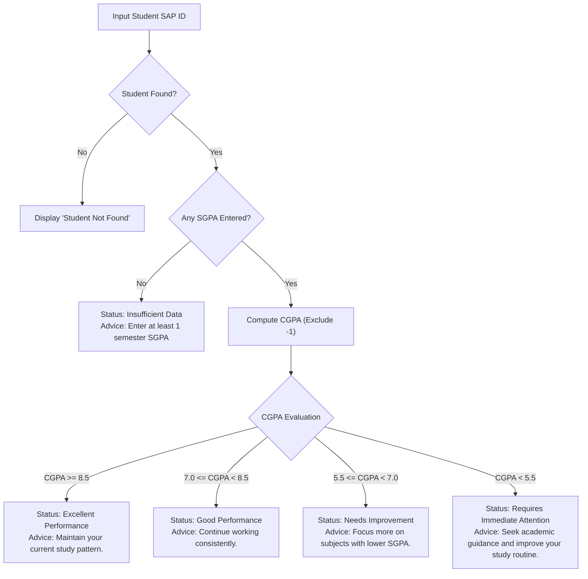

# Student Record and Result Management System

A modular, console-based academic management application developed in **Standard C (C99)** for first-year B.Tech Computer Science & Engineering (CSE) students. The system enables colleges and departments to manage student records, calculate semester/cumulative grade points, perform data sorting, and provide automated academic advisory feedback.

---

## Project Objectives

1. **Academic Record Maintenance**: Provide a centralized, menu-driven interface to register, search, display, and delete student academic and contact records.
2. **Result Computation**: Accurately calculate individual Cumulative Grade Point Average (CGPA) and batch-wise yearly averages using dynamic SGPA aggregation while skipping pending or unentered results.
3. **Data Organization**: Implement fundamental computer science algorithms (such as Bubble Sort and linear search) to sort and locate student records by unique identifiers (SAP ID) or alphabetical name.
4. **Intelligent Advisory Support**: Demonstrate a rule-based expert system that simulates an AI-assisted academic advisor, categorizing student performance and generating targeted advice.

---

##  Features

The application provides a numbered console menu with **10 core functionalities**:

| Option | Feature | Description |
| :---: | :--- | :--- |
| **1** | **Add Student** | Inserts a new student record after validating positive numeric inputs, bounds (Year 1–4, Semester 1–8, SGPA 0–10), and ensuring SAP ID uniqueness. |
| **2** | **Search Student** | Searches for a student by their unique SAP ID using linear search and prints a detailed academic profile card. |
| **3** | **Calculate CGPA** | Computes a student's CGPA by averaging only completed semester SGPAs (ignoring unentered semesters marked with `-1`). |
| **4** | **Average CGPA by Year** | Calculates and tabulates the average CGPA for each academic cohort (Year 1 through Year 4), filtering out students without entered grades. |
| **5** | **Display All Students** | Displays all currently enrolled students in a clean, human-readable card format with real-time CGPA and semester SGPA breakdown. |
| **6** | **Delete Student** | Removes a student record by SAP ID using contiguous array shifting, confirming user intent before deletion and zeroing out vacated memory. |
| **7** | **Sort by SAP ID** | Sorts student records in ascending order of their 9-digit SAP ID using an optimized Bubble Sort algorithm. |
| **8** | **Sort by Name** | Sorts student records in alphabetical order by student name using `strcmp()` and full structure swapping. |
| **9** | **Academic Advisor** | Rule-based AI decision support that evaluates a student's CGPA against institutional benchmarks and delivers personalized guidance. |
| **10** | **Exit** | Terminates the interactive console session safely with a clean status code (`0`). |

---

##  Technologies Used

* **Programming Language**: C (Standard C99)
* **Compiler**: GCC (GNU Compiler Collection) / MinGW
* **Header Files**:
  * `<stdio.h>`: Standard Input / Output operations (`printf`, `scanf`, `getchar`)
  * `<string.h>`: String manipulation (`strcmp`, `strcpy`)
* **Data Structures**: Fixed-size arrays of structures (`struct Student`)
* **Platform**: Cross-platform console application (Windows, Linux, macOS)

---

##  Project Folder Structure

```text
student_record_system/
├── 590035827.c               # Complete C source code
├── 590035827.exe             # Compiled binary executable
├── README.md                 # Project documentation and user guide
└── tests/                    # Automated testing suite
    ├── sample_input.txt      # Automated test inputs for all 10 menu options
    └── sample_output.txt     # Expected terminal execution output
```

---

##  AI-Assisted Academic Advisor

Option `9` features a **rule-based expert system** inspired by artificial intelligence decision trees. It automatically retrieves a student's record, calculates their CGPA across completed semesters, and matches the score against institutional academic thresholds to provide actionable feedback:



### Advisory Threshold Breakdown:
1. **$\text{CGPA} \ge 8.5$ — Excellent Performance**: High-achieving academic tier. Advised to maintain study habits and explore advanced subjects or research.
2. **$7.0 \le \text{CGPA} < 8.5$ — Good Performance**: Strong, consistent academic standing. Advised to stay consistent and aim for higher honors.
3. **$5.5 \le \text{CGPA} < 7.0$ — Needs Improvement**: Moderate academic standing. Advised to identify and strengthen specific subjects with lower grade points.
4. **$\text{CGPA} < 5.5$ — Requires Immediate Attention**: Critical standing. Advised to seek direct faculty mentoring and restructure revision schedules.
5. **Pending / Unentered Result**: If all semesters are `-1`, the advisor alerts the user that evaluation data is insufficient.

---

##  How to Compile

Open your terminal or command prompt and navigate to the project directory:

```bash
cd student_record_system
```

Compile the program using GCC with standard warning checks:

```bash
gcc -Wall -Wextra -std=c99 590035827.c -o 590035827.exe
```

* Flags used:
  * `-Wall -Wextra`: Enables all standard compiler warnings to verify clean code hygiene.
  * `-std=c99`: Ensures adherence to the C99 language standard.

---

##  How to Run

### 1. Interactive Console Mode
Run the executable directly in your command line:

* **Windows**:
  ```powershell
  .\590035827.exe
  ```
* **Linux / macOS**:
  ```bash
  ./590035827
  ```

Follow the on-screen numbered prompts to add students, calculate results, sort records, or consult the academic advisor.

---

### 2. Automated Test Mode (Using `tests/`)
You can feed predefined test inputs into the application to verify all features in a single automated pass:

* **Windows (PowerShell)**:
  ```powershell
  Get-Content .\tests\sample_input.txt | .\590035827.exe
  ```

* **Linux / macOS (Bash)**:
  ```bash
  ./590035827 < tests/sample_input.txt
  ```

To compare against the expected output, inspect [sample_output.txt](file:///C:/Users/Manav/.gemini/antigravity/scratch/student_record_system/tests/sample_output.txt).

---

##  Author Information

* **Name**: Manav Rawat
* **SAP ID**: 590035827
* **Program**: B.Tech Computer Science & Engineering (CSE)
* **Semester**: 1st Year (First-Year Project)
